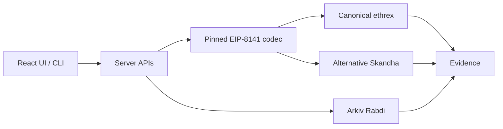

# FrameFuzz

**Break the tx before the mempool does**

FrameFuzz is an EIP-8141 **admission comparison lab**: it constructs signed type-`0x06` frame transactions, submits the **same transaction identity** to the **public/canonical ethrex** path and the **alternative Skandha** mempool, and records policy divergence separately from inclusion and frame execution.

Built for [ETHGlobal Mumbai 2026](https://ethglobal.com/events/mumbai). Submission package: [`docs/submission/ETHGLOBAL_SUBMISSION.md`](docs/submission/ETHGLOBAL_SUBMISSION.md).



## Problem

Frame transactions add validation-time rules (storage access, verification gas, payers, stake). A contract can compile and simulate yet be **rejected at admission** on the public path while an alternative mempool accepts it. Without dual-path tooling, that looks like RPC noise.

## What works today

| Capability | Status |
|---|---|
| Signed EIP-8141 construction (pinned `ethrex-eip8141-tracer` codec) | Supported scenarios |
| Canonical vs alternative admission comparison | **LIVE** |
| Flagship policy divergence (`StorageReadNonSender`) | **LIVE** — see below |
| Solidity analyze + source/runtime binding | Supported scenarios |
| Feasibility-gated mutations + agent roles (Scout → Mutation → Validator → Critic) | Supported; model calls need keys |
| Uniswap v4 **StateView.getSlot0** in paymaster validation | **LIVE** evidence (not a swap) |
| Arkiv publish / query / unsigned import (Rabdi **7794095**) | **LIVE** publish + user-facing reads |
| Ethereum Swarm **Bee** storage | **Not implemented** |

**Admission ≠ inclusion ≠ successful frame execution.**

### Flagship LIVE Uniswap policy divergence

| | |
|---|---|
| Transaction | [`0x72a82645d0f0d5d1ed2d537976b3580ab92b65720cd07a61e76200a2cc96b067`](evidence/live/2026-11-07/uniswap-policy-divergence-final.json) |
| Canonical | `REJECTED_POLICY` — `StorageReadNonSender` |
| Alternative | `ACCEPTED_AND_INCLUDED` — Skandha admission ID **2065** |
| Inclusion | Outer receipt `0x1`; **3/3 frame receipts successful** |
| Integration | `ReserveReadingPaymaster` PAYMENT VERIFY → Uniswap v4 `StateView.getSlot0(poolId)` |

The earlier generic storage-access hash `0xf69e0f4b…` remains useful captured evidence (Skandha admission 1647, later dropped), but the Uniswap candidate above is the primary product proof because it combines source/runtime binding, real protocol-state access, policy divergence, alternative admission, and successful frame execution.

## Judge / sponsor docs

| Doc | Purpose |
|---|---|
| [docs/submission/ETHGLOBAL_SUBMISSION.md](docs/submission/ETHGLOBAL_SUBMISSION.md) | Main write-up |
| [docs/submission/REQUIREMENTS_CHECKLIST.md](docs/submission/REQUIREMENTS_CHECKLIST.md) | Portal checklist |
| [docs/submission/PROOF_INDEX.md](docs/submission/PROOF_INDEX.md) | Claim → proof map |
| [docs/submission/CONTRACT_ADDRESSES.md](docs/submission/CONTRACT_ADDRESSES.md) | Addresses & txs |
| [docs/submission/DEMO_RUNBOOK.md](docs/submission/DEMO_RUNBOOK.md) | Live demo script |
| [docs/sponsors/ETHEREUM_FOUNDATION.md](docs/sponsors/ETHEREUM_FOUNDATION.md) | EF alt mempool evidence map |
| [docs/sponsors/UNISWAP.md](docs/sponsors/UNISWAP.md) | Uniswap StateView evidence map |
| [docs/sponsors/ARKIV.md](docs/sponsors/ARKIV.md) | Arkiv write/read evidence map |
| [docs/sponsors/SWARM.md](docs/sponsors/SWARM.md) | Swarm bonus — not eligible yet |
| [FEEDBACK.md](FEEDBACK.md) | Uniswap DX feedback (**form submitted** 2026-11-07) |
| [arkiv/swarm.md](arkiv/swarm.md) | Required Swarm status file |

Recommended partner prizes (≤3): **EF Frame Transaction Alternative Mempool**, **Uniswap Foundation**, **Arkiv Build on Arkiv**. Do **not** select Arkiv+Swarm until Bee exists.

Official deadline: **Saturday 7 November 2026, 09:00 IST** — [event details](https://ethglobal.com/events/mumbai/info/details).

## Quick start

Node **20.12+**. Never commit `.env`.

```powershell
npm ci
npm test
npm run ui:build
node --env-file=.env bin/framefuzz.mjs serve --mode LIVE_READ_ONLY --results runs --port 4190
```

Saved demo (no keys / no chain writes):

```powershell
node bin/framefuzz.mjs saved-demo --results runs/demo --port 4192
```

UI: React + MUI app in `web-ui/` (build → `web/dist/`). Dev proxy: `npm run ui:dev`.

### Vercel + OCI live lab

- **Vercel** serves the static UI (`web/dist`) and a thin `/api` function (`api/index.mjs`).
- Without `FRAMEFUZZ_BACKEND_URL`, `/api` stays **SAVED_DEMO** (offline historical evidence).
- With `FRAMEFUZZ_BACKEND_URL=http://<oci-host>:4190`, Vercel **proxies** `/api` to the OCI live Node backend (`LIVE_AUTHORIZED`). Operator keys never ship in the Vercel bundle — they live only on OCI (`/etc/framefuzz/framefuzz.env`).
- Full install: [deploy/oci/README.md](deploy/oci/README.md).

### Environment variable **names** (values never in git)

`OPENROUTER_API_KEY`, `OPENROUTER_MODEL`, `OPENROUTER_ENDPOINT`, `ARKIV_PRIVATE_KEY`, `ARKIV_ACCESS_KEY`, `ARKIV_READER_ADDRESS`, `FRAMEFUZZ_DEPLOYER_KEY`, `FRAMEFUZZ_OWNER_KEY`, `FRAMEFUZZ_SENDER_KEY`, `FRAMEFUZZ_RPC`, `FRAMEFUZZ_PUBLIC_RPC`, `FRAMEFUZZ_ALT_RPC`, `FRAMEFUZZ_LIVE_CONFIG`, `FRAMEFUZZ_BACKEND_URL` (Vercel → OCI), `FRAMEFUZZ_CORS_ORIGINS`, `FRAMEFUZZ_ALLOW_PUBLIC_HOST`, optional `FRAMEFUZZ_SWARM=on` (AI swarm experiments — **not** Ethereum Swarm storage).

Modes: `SAVED_DEMO` · `LIVE_READ_ONLY` · `LIVE_AUTHORIZED` (writes still require explicit approval gates).

## Architecture (short)

- **Codec:** `src/adapters/workshop-codec.mjs` (`ethrex-eip8141-tracer`)
- **Compare:** `src/policy-comparison.mjs`
- **Live product:** `src/playground/live-admission.mjs`, `storage-access-regression.mjs`
- **Uniswap state checks:** `src/adapters/uniswap-state.mjs` + `vendor/paymaster/ReserveReadingPaymaster.sol`
- **Arkiv:** `src/arkiv/*`, UI `web-ui/src/pages/Arkiv.tsx`, SDK `@arkiv-network/sdk@1.0.1`
- **Agents:** feasibility-gated Scout / Mutation / Validator / Critic (see `docs/AGENTIC_FEASIBILITY.md`)

## Arkiv (Rabdi)

Chain **7794095**. Example LIVE entity (2026-11-07):

- Entity `0xf1089c05e4a7ec4d3a66087381c1c78b43728a836e4ae10eb694cfd6ce2a06a1`
- Tx `0x007bd10f4d720a124c4dd0b44449f235b32f364a4b68e7657917f1717a307c00`
- Writer `0x20370BE5BA867Ab4779ad0686963A55ADc0722b1`
- Digest `0f7f014559fbfb6ea828820cc954401f1562937b66c2fe24360959dcb5196b25`

Additional historical writers/entities are listed in [docs/sponsors/ARKIV.md](docs/sponsors/ARKIV.md). Public query/import needs no writer key.

```powershell
node bin/framefuzz.mjs arkiv query --suite verification-gas --rule MAX_VERIFY_GAS
```

Sponsor criterion files: [arkiv/schema.md](arkiv/schema.md), [friction](arkiv/friction.md), [reach](arkiv/reach.md), [why-arkiv](arkiv/why-arkiv.md), [how-you-use-arkiv](arkiv/how-you-use-arkiv.md).

## Uniswap integration pointer

Paymaster VERIFY (`0x01`) → `StateView.getSlot0(poolId)` in [`vendor/paymaster/ReserveReadingPaymaster.sol`](vendor/paymaster/ReserveReadingPaymaster.sol). Addresses and LIVE tx: [docs/sponsors/UNISWAP.md](docs/sponsors/UNISWAP.md). No swap / LP / USDC reimbursement claimed.

## Tests

```powershell
npm test
```

Observed **2026-11-07**: **239** tests, **236** pass, **3** fail. Do not claim a fully green suite until failures are fixed. Historical checkpoint: [`docs/TEST_CHECKPOINT.json`](docs/TEST_CHECKPOINT.json).

## Unsupported / limits

- Arbitrary pasted Solidity does **not** automatically become a complete EIP-8141 executable flow
- Ethereum Swarm Bee storage not implemented
- Mainnet / real funds out of scope
- Public GitHub accessibility and portal video/URL fields are **human** submission steps — this audit saw origin URL HTTP **404** for anonymous access

## License & AI

**MIT** ([LICENSE](LICENSE)). AI assisted implementation, tests, docs, and bounded agent calls; distinguish mocked/preview data from LIVE evidence. Specs/prompts retained in-repo where used.

## Security

Keys only in environment variables. `.env` is gitignored. Judges must not receive spendable operator wallets. Report secret exposure privately — never paste keys into issues or submission forms.
