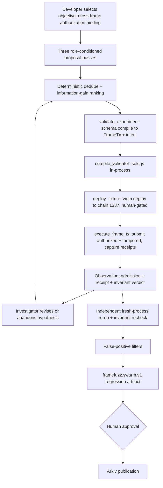

# FrameFuzz Swarm — architecture and feasibility plan (revision 2)

Status: **Approved architectural plan, not a live-results report.** Current implementation/evidence is recorded in [SWARM_MILESTONES.md](SWARM_MILESTONES.md). The user's later corrections govern: initial attack changes calldata while retaining the target and owner witness; action execution must be proved independently of admission/outer receipts; current work stops after read-only preparation. No live deployment, broadcast or Arkiv write is authorized by implementation approval. Claims below about future execution are prospective, not observed results.

Revision 2 supersedes revision 1 under the new authorization to **extend and change the implementation**. The agentic system is no longer constrained to `buildSponsored`, the paymaster `0x02` branch, or the two existing semantic dimensions. Revision 1's offline-codec framing is now the *fallback*, not the product.

Plan authored: November 6, 2026 (IST). Deadline (`AUTHORITY.md`): **November 7, 2026, 09:00 IST**.

---

## 0. What changed since revision 1, and why it matters

Two read-only discoveries move the primary experiment from "prove the codec signs correctly" to "execute a real cross-frame authorization attack on an EIP-8141 client."

1. **Solidity compiles in-process, no toolchain.** `@forshtat/hegota-support` ships `compileSolidity(name, source, options)` (`node_modules/@forshtat/hegota-support/dist/solidity/index.js`). It drives `solc-js`, resolves `import "@forshtat/hegota-support/contracts/..."` against the package, and returns `{ abi, bytecode }`. Its only requirement is the optional peer dependency `solc@0.8.28`. `forge`/`anvil`/`cast` remain absent and are no longer needed. This removes the single blocker that forced revision 1 away from real contracts.

2. **The devnet executes frame transactions, and I verified it is live.** A read-only probe of `https://altmempool.forshtat.com/rpc` returned chain `0x539` (1337) and `skandha_explorer_info` v4.1.1 at `latestSeq` 5421. Committed evidence (`docs/LIVE_EVIDENCE.md`, `evidence/live/2026-11-06/...3a838bca.json`) shows historical frame transactions reaching **`INCLUDED_SUCCESS`** with real block numbers and `status 0x1`, and the sidecar performing full validation-prefix simulation (24 checks). The ethrex `eip8141-tracer` is the **only** environment that implements the frame opcodes (`APPROVE 0xaa`, `TXPARAM 0xb0`, `FRAMEPARAM 0xb3`, `SIGPARAM 0xb4`, `SIGDATACOPY 0xb5`). Ordinary Anvil does not, and the plan does not pretend otherwise.

3. **The Solidity opcode surface is exactly what a sender validator needs.** `contracts/HegotaSupport.sol` exposes `approve(Scope)`, `txparam(TxParam)`, `frameparam(i, FrameParam)`, `framedatacopy(...)`, `sigparam(i, SigParam)` and `sigdatacopy(...)`. `contracts/Params.sol` defines `TxParam.SIG_HASH` and `FrameParam.RESOLVED_TARGET`/`DATA_LENGTH`/`ALLOWED_SCOPE`. A smart-account validator can therefore read the canonical signature hash and the actual frame set from inside its own VERIFY frame — the primitives required to bind, or to fail to bind, an authorization. This is a real, standard account-abstraction threat model, executable here.

Net effect: we can compile two sender-validator accounts, deploy them to a live EIP-8141 client, and show one accepting an unauthorized frame change that the other rejects — then reproduce it independently. That is a genuine adversarial security result, not an encoding demonstration.

---

## 1. Revised architecture

### Shape: one investigator, three proposal lenses, deterministic coordinator, independent verifier

Unchanged from revision 1 and still the right call: three *autonomous* LLM agents trebles cost, latency and prompt-injection surface for three domains that share one tool set. We run **one model** with three role-conditioned proposal passes (Validation / State / Differential adversary), a deterministic non-LLM coordinator, one investigation loop, and an independent reviewer. The dashboard shows three genuinely different perspectives (different context slices) and says plainly they are role-conditioned passes, not three agents.

What revision 2 adds underneath that loop is a **real execution spine**:

The LLM owns *which valid attack variation to construct*. The deterministic engine owns compilation, deployment, submission, invariant evaluation and every verdict. Broadcasting and deployment are human-gated; the model can never trigger a network write.

### Isolation and kill switch

Everything new lives under `src/swarm/` plus two new leaf modules (`src/mutations/frames.mjs`, `src/adapters/sender-validator.mjs`) and two new contracts under `contracts/`. The feature is reached only through a new `swarm` CLI subcommand and additive `/api/swarm/*` routes. Setting `FRAMEFUZZ_SWARM=off` (or simply not invoking the subcommand/routes) disables it entirely. The v1 engine, its 71 tests, historical evidence, Arkiv registry and offline demo are untouched by construction.

---

## 2. Revised primary experiment: cross-frame authorization binding

### The real vulnerability class

In EIP-8141, a VERIFY frame whose signature entry uses scheme `ARBITRARY` (profile `sigSchemes.ARBITRARY = 0`) is *self-validated*: the protocol checks no secp256k1 signature, and the account's own code decides validity. This is the account-abstraction authorization surface. A smart-account sender that authorizes execution from an owner "intent" must bind that intent to the **complete authorized frame set**. If it binds to less, an attacker who holds the intent can alter execution frames and still pass validation.

Two fixtures express the difference, compiled from self-contained sources that import the shipped `HegotaSupport`:

- **`SenderValidatorUnsafe`** — in its VERIFY(EXECUTION) frame it reads the intent signature via `sigdatacopy`, `ecrecover`s it over a **partial** message (only the action target, read via `frameparam(actionIndex, RESOLVED_TARGET)`), checks `signer == OWNER`, and `approve(Scope.EXECUTION)`. It never reads `txparam(TxParam.SIG_HASH)`, so it does not commit to calldata or to the rest of the frame set.
- **`SenderValidatorSafe`** — identical, except the signed message is `txparam(TxParam.SIG_HASH)` (the canonical hash over the entire transaction). Any change to any execution frame changes `SIG_HASH`, so the stale intent fails `ecrecover`/equality and the frame reverts.

### Honouring EIP-8141 exactly (per the brief)

- **Execution approval targets `tx.sender`.** The VERIFY(EXECUTION) frame targets the sender-validator account; its fallback runs `approve(Scope.EXECUTION)`.
- **Separate paymaster approves payment only.** The existing funded basic paymaster `0x3464...ea30` supplies a VERIFY(PAYMENT) frame → `approve(Scope.PAYMENT)`. Unchanged behaviour.
- **Flags permit the requested scope.** Each frame's `flags` low bits carry its scope (`frame()` ORs `approveScope` into flags); the account only approves within `FrameParam.ALLOWED_SCOPE`.
- **Sender approval precedes payer approval.** Frame order: `[VERIFY EXECUTION → sender account, VERIFY PAYMENT → payer, SENDER → action target]`, matching the existing working transaction order and the brief's ordering rule.
- **No protocol-prohibited setup.** The validator reads only its own transaction's frames/signature via introspection opcodes — these are transaction fields, not another entity's storage, so `StorageReadNonSender` does not apply. We do not attempt unstaked external storage reads or any rule the mempool already forbids.

### The attack the agent constructs

Hold the owner's intent signature fixed. Produce two transactions:

- **Authorized** — the SENDER (action) frame the owner meant to approve.
- **Tampered** — the same intent, but the agent mutates the action frame: change its `RESOLVED_TARGET`, change its calldata, add a second execution frame, or reorder. All are valid EIP-8141 layouts; none is a prohibited setup.

Submit both to each account on the live devnet:

| Fixture | Authorized tx | Tampered tx | Meaning |
|---|---|---|---|
| `SenderValidatorUnsafe` | INCLUDED_SUCCESS | **INCLUDED_SUCCESS** | Unauthorized frame change accepted → binding violated |
| `SenderValidatorSafe` | INCLUDED_SUCCESS | **REJECTED / revert** | Same change rejected → binding holds |

The agent's real decisions: which field to mutate, how to construct a still-valid frame layout, which signature-binding strategy distinguishes the fixtures, and whether an observation refutes its prediction. The space of valid tampering layouts is far larger than anything the v1 generator enumerates.

---

## 3. Exact code and contract changes

New files (all additive):

- `contracts/SenderValidatorUnsafe.sol` — self-contained, `import {HegotaSupport, Devnet, Scope, TxParam, FrameParam, SigParam} from "@forshtat/hegota-support/contracts/HegotaSupport.sol"`. ~70 lines. Constructor takes `owner`, `actionFrameIndex`. No production security model (stated in source, as `vendor/paymaster` does).
- `contracts/SenderValidatorSafe.sol` — same surface, binds to `txparam(TxParam.SIG_HASH)`. ~70 lines.
- `src/swarm/compile.mjs` — wraps `compileSolidity`; whitelists these two source paths; caches `{abi,bytecode}` by source hash; writes nothing outside `runs/`.
- `src/adapters/sender-validator.mjs` — a new deterministic adapter (plugin for the existing `createAdapter` wrapper) that: deploys an account via the `deployReserve` viem pattern; builds a frame tx with sender = the account, an `ARBITRARY` signature entry carrying the owner intent bytes, frames in the EIP-8141-correct order; queries the account nonce through the devnet nonce manager; returns `{raw, submission, metadata}`. Reuses isolated-account and poisoned-session guards from `src/adapters/index.mjs`.
- `src/mutations/frames.mjs` — Frame Mutation Engine v2: the `frame-authorization` suite. Produces the authorized layout plus a schema-validated tampered layout from a symbolic mutation descriptor. Deterministic, regenerable from a descriptor exactly like `src/mutations/generator.mjs`.
- `src/swarm/{provider,hypothesis,tools,coordinator,verifier,objectives,report}.mjs` — as in revision 1, with `tools.mjs` now exposing `compile_validator`, `deploy_fixture` and `execute_frame_tx` (the last two human-gated and never model-callable for broadcast).
- `src/swarm/invariant.mjs` — the deterministic cross-frame binding invariant (section 4).
- Tests: `test/frame-authorization.test.mjs`, `test/sender-validator-adapter.test.mjs`, `test/swarm-{coordinator,hypothesis,verifier,provider,invariant}.test.mjs`, `test/compile.test.mjs`.

Edited files (each change version- or flag-gated so v1 behaviour is byte-identical):

- `src/mutations/generator.mjs` — add `GENERATOR_VERSION_V2 = 'framefuzz.semantic.v2'` and `'frame-authorization'` to `MUTATION_SUITES`; branch on version; the frame suite's field allowlist lives entirely under v2. A test asserts a v1 definition's `digest` is unchanged.
- `src/mutations/campaign.mjs` — accept v2 definitions in `loadMutationDefinition`; keep the 7-variant live cap and all chain/evidence guards.
- `src/arkiv/case.mjs` — add `frame-authorization` to `portableDefinition`'s suite allowlist and a `FRAME_AUTHORIZATION` label to the `ruleId` assertion. Existing v1 digests still validate.
- `src/server.mjs` — three additive routes `/api/swarm/{config,run,transcript}`, reusing the `running` mutex, Origin check and body cap.
- `web/index.html` — one additive `#swarm` section mirroring `#community`.
- `bin/framefuzz.mjs` — one `swarm --objective <id> [--offline] [--deploy] [--submit --allow-chain 1337]` subcommand.
- `package.json` — add optional/dev dependency `solc@0.8.28` (the one justified toolchain addition; pure JS, no native build).

---

## 4. Actual execution environment

| Backend | Available | Proves | Role |
|---|---|---|---|
| **solc-js `compileSolidity`** | after `npm i solc@0.8.28` | Real EIP-8141 account bytecode from source | Compile step, both paths |
| **Live ethrex devnet, chain 1337** | **yes, verified answering** | Real frame-opcode execution: admission + `INCLUDED_SUCCESS` receipts + validation-prefix simulation | **Primary real execution** |
| In-process EVM fallback (`ethereumjs/evm`) | optional 2nd dep | The validator's `ecrecover`/binding logic in harness mode, frame values passed as calldata | Labelled `CONTRACT_LEVEL` fallback only |
| Codec-only invariants (revision 1) | yes | Signature-commitment coverage, offline | Secondary offline oracle |
| Anvil / generic EVM for frame semantics | — | **Nothing** about frame lifecycle | Explicitly excluded |

**Primary path:** compile both validators with solc-js, deploy to chain 1337 via the `deployReserve` viem pattern (funded `FRAMEFUZZ_DEPLOYER_KEY`, human-gated), submit authorized + tampered transactions through the existing `runSuite`, capture receipts. This is real EIP-8141 execution on the only client that implements it.

**If the devnet is offline or the operator declines broadcast:** fall back to `CONTRACT_LEVEL` execution of the validators' binding logic in an in-process EVM (harness mode, frame values supplied as calldata since introspection opcodes are absent off-devnet), plus the codec-level `SIG_HASH` differential from revision 1. This proves the `ecrecover`/binding difference deterministically but **not** on-chain frame semantics, and every artifact and UI banner says exactly that. Reassessment: even in fallback the dimension is worth shipping, because the compiled bytecode and the binding invariant are real and the narrative (agent reads two validators, constructs a tampering that splits them) holds; only the "executed on a live EIP-8141 node" claim is downgraded to "executed at contract level."

No Anvil result is ever presented as EIP-8141 lifecycle proof.

---

## 5. Testable security invariant

**Cross-frame authorization binding.** For a sender-validator account `V` with owner `O`: if `O`'s intent authorizes transaction `T_auth`, then `V` approves `Scope.EXECUTION` for a submitted transaction `T` **iff** `T`'s canonical signature hash equals that of `T_auth` (equivalently, the intent commits to `txparam(TxParam.SIG_HASH)`).

- Violated by `SenderValidatorUnsafe`: approves `T_tampered` where `sigHash(T_tampered) != sigHash(T_auth)`.
- Satisfied by `SenderValidatorSafe`: rejects `T_tampered`, approves only `T_auth`.

Deterministic evaluation, assigned by `src/swarm/invariant.mjs` from a closed verdict set, never by the model:

- `BOUND_HOLDS` — authorized included, tampered rejected (safe fixture).
- `BINDING_VIOLATED` — authorized included **and** tampered included (unsafe fixture); the headline adversarial result.
- `PRECONDITION_FAILURE` — deploy/funding/nonce/gas error class; not a finding.
- `INFRASTRUCTURE_FAILURE` — `gateway_infrastructure` (disk full etc.); not a finding.
- `INCONCLUSIVE` — unverified provenance, client-version drift, or non-reproducing observation.

`sigHash(T_tampered) != sigHash(T_auth)` is checked offline with the real codec (revision 1 proved this works), so the invariant has a deterministic oracle independent of the chain, while the chain provides the real accept/reject behaviour.

---

## 6. Estimated implementation effort

Smallest end-to-end that delivers one compelling adversarial investigation: **6 to 9 hours.**

- Contracts + compile wrapper + compile test: ~1.0 h.
- Sender-validator adapter (deploy, frame build, ARBITRARY intent, nonce) + tests: ~2.0 h — the highest-risk piece (nonce manager and ARBITRARY-scheme construction are new).
- Frame Mutation Engine v2 + v2 generator gating + digest-preservation test: ~1.5 h.
- Invariant + verifier (fresh-process rerun) + tests: ~1.0 h.
- Swarm loop (provider, hypothesis/observation schemas, coordinator, tool registry, `SWARM_SIMULATED` fallback) + tests: ~1.5 h.
- CLI + three dashboard routes + `#swarm` panel: ~1.0 h.
- Contingency for live-submission iteration: ~1.0 h.

New tests: **22 to 28**, taking the suite to roughly 95. Dependencies: `solc@0.8.28` (required), `ethereumjs/evm` (only if the fallback is built). Credentials: `FRAMEFUZZ_LLM_API_KEY` for the agent; `FRAMEFUZZ_DEPLOYER_KEY` for deployment (human-gated, already used by `deployReserve`). LLM cost: ~USD 0.10–0.30 per run, 10 calls, <60k tokens.

**Cut list if time is short**, each cut leaving a coherent demo: (1) reviewer call; (2) Differential lens → two perspectives; (3) dashboard panel → CLI + saved artifact in the existing evidence explorer; (4) live submission → `CONTRACT_LEVEL` fallback as the demo; (5) Arkiv export of the new suite → keep artifacts local. **Never cut:** the two fixtures, the deterministic invariant, the fresh-process verifier, or the three-tier `AI HYPOTHESIS / OBSERVED RESULT / VERIFIED FINDING` labelling.

**Reserve the final 90 minutes** for the unstarted mandatory items in `docs/SUBMISSION_CHECKLIST.md`: authorized GitHub push and public-access check, the Uniswap developer feedback form, the demo recording, and the ETHGlobal submission.

---

## 7. Safety, isolation and honesty controls

- LLM request cap 12; executions: offline unlimited within budget, **deploy and live submit only on explicit human action**; live batches inherit `MAX_LIVE_MUTATIONS = 7`, `--submit --allow-chain 1337`, and `assertTestChain` (mainnet hard stop).
- The model cannot select a backend, read arbitrary files, write files, deploy, or broadcast. `deploy_fixture`/`execute_frame_tx` are not exposed to the model.
- All untrusted text (contract source, RPC errors, Arkiv records) is passed inside a delimited `untrusted` field, truncated, never interpreted as instructions; tool names matched against an allowlist by exact string; model output parsed as JSON and schema-validated, prose discarded.
- Credentials from environment only (`FRAMEFUZZ_LLM_API_KEY`, `FRAMEFUZZ_DEPLOYER_KEY`), never logged or committed, scrubbed by `redact`. Ephemeral/compile keys never persisted.
- Provider unavailable → deterministic scripted proposals, every artifact and banner labelled `SWARM_SIMULATED — DETERMINISTIC FALLBACK, NO LLM`. Never called an autonomous swarm.
- Schema v2 preserves all v1 fixture digests; a test asserts an unchanged v1 `digest`. Historical evidence files are never edited at any milestone.
- No vulnerability is claimed without `BINDING_VIOLATED` reproduced in a fresh process; `oracle.mjs` confidence downgrades and the false-positive filters from revision 1 all remain. The fixture is labelled "no production security model" in source and UI.
- No competing project is named anywhere in FrameFuzz materials.

---

## 8. Go / No-Go decision

**GO — build the revised primary experiment on the live devnet, with the `CONTRACT_LEVEL` fallback wired in from the start.**

Justification: the toolchain blocker is gone (`compileSolidity` + `solc-js`), the only EIP-8141-capable client is verified live with a history of successful inclusions, and the opcode surface (`txparam(SIG_HASH)`, `sigdatacopy`, `approve`) is exactly sufficient to express a real, standard cross-frame authorization vulnerability with a corrected control. The LLM makes genuine, non-enumerable choices; the deterministic engine owns execution and verdicts; the result is independently reproducible. Risks (nonce-manager/ARBITRARY construction, operator-controlled devnet) are contained by the fallback and the human-gated broadcast, and the v1 product is preserved by strict versioning and isolation.

No-Go would apply only if, during milestone 2, the sender-validator transaction cannot be admitted at all (not merely rejected) after reasonable effort — in which case ship the `CONTRACT_LEVEL` fallback as the demo and label the live claim as not established.

### Milestones and acceptance

| # | Milestone | Acceptance |
|---|---|---|
| 1 | Compile both fixtures | `compileSolidity` returns bytecode for both; 71 existing tests still pass |
| 2 | Deploy + admit one authorized account tx | One frame tx from a deployed validator reaches admission on chain 1337 (human-gated); nonce/ARBITRARY construction verified |
| 3 | Frame Engine v2 + invariant | Authorized vs tampered layouts regenerate from a descriptor; v1 digest provably unchanged; invariant verdicts unit-tested |
| 4 | End-to-end split | Unsafe = `BINDING_VIOLATED`, Safe = `BOUND_HOLDS`, each reproduced in a fresh process |
| 5 | Swarm loop | `SWARM_SIMULATED` works with no key; schema rejects malformed hypotheses; coordinator rejects already-covered proposals with recorded reasons |
| 6 | CLI + dashboard + artifact | `framefuzz.swarm.v1` artifact via `saveReport`; `#swarm` panel renders three perspectives, the chosen experiment, the split result and the fresh-process verification; existing panels unchanged |

Rollback: each milestone is a separate conventional commit; the feature is additive and version/flag-gated; `git revert` of the swarm commits restores the 71-test baseline exactly.

---

## Questions requiring your approval before implementation

1. **Live broadcast.** Authorize one human-gated deployment of the two validators plus a bounded submission campaign (≤7 variants, `--submit --allow-chain 1337`) on chain 1337? If no, the feature ships as `CONTRACT_LEVEL` fallback.
2. **Dependency.** Approve adding `solc@0.8.28` (required), and optionally `ethereumjs/evm` only if the fallback is built?
3. **Deployer key.** Will `FRAMEFUZZ_DEPLOYER_KEY` be funded on chain 1337 and supplied via environment for the human-gated deploy?
4. **LLM provider.** Which provider/model, and will `FRAMEFUZZ_LLM_API_KEY` be available? Without it the feature ships `SWARM_SIMULATED`.
5. **Scope.** Confirm the smallest-viable scope (single unsafe-vs-safe investigation, cut list in section 6) rather than free-form frame-graph search, to protect the 90-minute submission reserve.

**Proceed with the revised live-execution plan, or constrain it to the `CONTRACT_LEVEL` fallback for this submission?**
