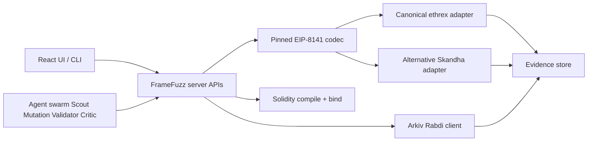

# FrameFuzz — ETHGlobal Mumbai 2026 submission write-up

**Project:** FrameFuzz  
**Tagline:** Break the tx before the mempool does  
**Event:** [ETHGlobal Mumbai](https://ethglobal.com/events/mumbai)  
**Submission deadline (official):** Saturday, 7 November 2026, **09:00 am IST** ([event details](https://ethglobal.com/events/mumbai/info/details))  
**Partner prize cap:** select up to **3** partner prizes ([event details](https://ethglobal.com/events/mumbai/info/details))

This document is the judge-facing technical narrative. Claims map to concrete proof in [PROOF_INDEX.md](./PROOF_INDEX.md). Sponsor evidence maps: [ETHEREUM_FOUNDATION.md](../sponsors/ETHEREUM_FOUNDATION.md), [UNISWAP.md](../sponsors/UNISWAP.md), [ARKIV.md](../sponsors/ARKIV.md), [SWARM.md](../sponsors/SWARM.md).

---

## 1. Problem

EIP-8141 **frame transactions** (type `0x06`) introduce validation-time semantics that ordinary Ethereum tooling does not exercise: payers, validation gas, storage-access rules, and **admission policy** that can diverge between a **public/canonical** mempool and an **alternative** mempool.

Developers can ship contracts that compile, simulate locally, and still be **rejected at admission** (or accepted only by a looser alternative path). Without a side-by-side admission lab, those failures look like “RPC noise” instead of **policy divergence**.

## 2. Solution (what FrameFuzz actually does)

FrameFuzz is a **local-first EIP-8141 admission comparison lab**:

1. Analyze supported Solidity (compiler facts, source→runtime binding where available).
2. Generate **feasible** mutations (not arbitrary pastes claiming full EIP-8141 execution).
3. Construct and sign real type-`0x06` frame transactions (pinned EIP-8141 codec).
4. Submit the **same transaction identity** to:
   - **Canonical ethrex** gateway (public path)
   - **Alternative Skandha** mempool (alternative path)
5. Compare admission verdicts, then separately track inclusion / mempool status / frame receipts when present.
6. Optionally publish portable regressions to **Arkiv** (Rabdi) and re-import them unsigned.
7. Surface results in a React UI and CLI/API for agents and operators.

**Admission ≠ inclusion ≠ successful frame execution.** Divergence evidence may stop at REJECTED_POLICY vs ACCEPTED (later DROPPED) without claiming on-chain frame success.

## 3. EIP-8141 context

- Frame transactions encode sender, payer, frames, nonce keys, and validation constraints.
- Canonical ethrex on the EF frame-tx chain applies strict validation-prefix simulation (e.g. `StorageReadNonSender`).
- Alternative Skandha admission can accept the same bytes under a different policy surface and report an admission ID.
- FrameFuzz pins codec/signature helpers under `vendor/eip8141/` and adapters under `src/` for both paths.

## 4. Why public vs alternative divergence matters

A single hash that is **policy-rejected** on canonical and **admitted** on alternative is a developer-visible bug class: tooling that only talks to one gateway will mis-train intuition. FrameFuzz’s primary EF deliverable is that **same-transaction dual-path comparison** with retained raw responses.

Flagship LIVE divergence (Uniswap v4 StateView paymaster path):

| Field | Value |
|---|---|
| Transaction | `0x72a82645d0f0d5d1ed2d537976b3580ab92b65720cd07a61e76200a2cc96b067` |
| Canonical | `REJECTED_POLICY` — `StorageReadNonSender` |
| Alternative | `ACCEPTED_AND_INCLUDED` — Skandha admission ID **2065** |
| Execution | Outer receipt `0x1`; all 3 frame receipts `0x1` |
| Evidence | [`evidence/live/2026-11-07/uniswap-policy-divergence-final.json`](../../evidence/live/2026-11-07/uniswap-policy-divergence-final.json) |

This proves a validation-time `StateView.getSlot0` read, not a swap, LP action, or USDC reimbursement.

Separate self-funded inclusion hashes (`0xd4d6123f…`, `0xc05703ac…`) prove canonical execution/inclusion paths, **not** a clean dual-path policy difference. See [PROOF_INDEX.md](./PROOF_INDEX.md).

## 5. Architecture

### Agent roles (AI swarm — not Ethereum Swarm storage)

| Agent | Role |
|---|---|
| Contract Scout | Reads compiler/source facts; proposes investigation targets |
| Semantic Mutation | Produces candidate mutations constrained by feasibility |
| Feasibility Validator | Rejects mutations that cannot be signed/submitted honestly |
| Evidence Critic | Scores admissions, divergence, and evidence completeness |

### Adapters

- **Public/canonical:** ethrex RPC methods for frame-tx submission and status (EF chain **1337**).
- **Alternative:** Skandha admission RPC + report polling.
- Construction always mutates **unsigned** models and **re-signs** variants; nonce/state isolated per admission path.

### Uniswap path (validation-time)

Prepared/LIVE paymaster path uses Uniswap v4 **StateView.getSlot0(poolId)** during **PAYMENT VERIFY** — not a swap UI. See [UNISWAP.md](../sponsors/UNISWAP.md).

### Arkiv path

Operator-authorized `createEntity` publication of `framefuzz.regression.v1`, user-facing query/import in UI and API. See [ARKIV.md](../sponsors/ARKIV.md).

### Ethereum Swarm storage

**Not implemented.** See [SWARM.md](../sponsors/SWARM.md) and [`/arkiv/swarm.md`](../../arkiv/swarm.md).

## 6. Frontend capabilities

React + MUI app (Vite): Contract Playground (analyze → mutate → dual admission), Comparisons, Campaigns, Evidence, Agents, Arkiv browse/import, Readiness, Briefing. Server serves the production build and JSON APIs. Hosted deployment (Render/Railway-class) is optional; local `npm start` is the verified baseline.

## 7. Local setup (names only)

See root [README.md](../../README.md). Required env **names** include (values never committed):

- `FRAMEFUZZ_OPERATOR_PRIVATE_KEY` / signing key envs used by operator flows
- OpenRouter / model gateway token envs used by agents
- Canonical and alternative RPC URL envs for EF chain 1337
- Arkiv/Rabdi RPC and writer key envs for publication
- Optional UI/server bind/port envs

Never commit `.env`. Judges must not receive spendable keys.

## 8. Tests

- Full Node suite: **239** tests registered; **2026-11-07** run observed **236 pass / 3 fail** (exit 1). Treat as NEEDS VERIFICATION for portal “all green” claims until failures are triaged.
- Historical checkpoint `docs/TEST_CHECKPOINT.json` may lag; prefer fresh `npm test` output.
- Production frontend build: `npm run build` (Vite) when `frontend/` is present.

## 9. Supported vs unsupported

**Supported**

- Signed EIP-8141 type-0x06 construction for supported scenarios
- Dual admission comparison (ethrex vs Skandha)
- Storage-access policy divergence demo (ViolatingWallet class)
- Solidity compile + source/runtime binding for supported contracts
- Mutation generation with feasibility gates
- Evidence capture and Arkiv publish/query/import
- Uniswap StateView validation-time paymaster path (see sponsor doc for LIVE vs PREPARED)

**Unsupported / limitations**

- Arbitrary pasted Solidity → full EIP-8141 execution is **not** guaranteed
- Ethereum Swarm Bee upload/retrieve **not implemented**
- Uniswap swaps, LP, initialized trading pools, USDC reimbursement — **not claimed** unless evidence says so
- Mainnet / real-funds operation — out of scope
- Public GitHub anonymity and live website URL — **verify at portal submit time**

## 10. Recommended prize selection (≤3 partners)

1. **Ethereum Foundation — EIP-8141 / Alternative Mempool** (primary)  
2. **Uniswap** (validation-time StateView paymaster tooling)  
3. **Arkiv — Build on Arkiv** (write + user-facing read)

Do **not** select Arkiv+Swarm bonus until Bee integration exists.

## 11. Manual portal actions (human)

- Submit on ETHGlobal/Devfolio before **09:00 IST 7 Nov 2026**
- Push public GitHub if not already public
- Upload demo video / thumbnail
- Uniswap feedback form: https://developers.uniswap.org/hackathon-feedback (see [FEEDBACK.md](../../FEEDBACK.md) — form submission status tracked separately)
- Confirm prize checkboxes ≤3 partners

---

*Provenance: repository working tree + `evidence/` + official ETHGlobal pages cited above. No fabricated hashes or addresses.*
